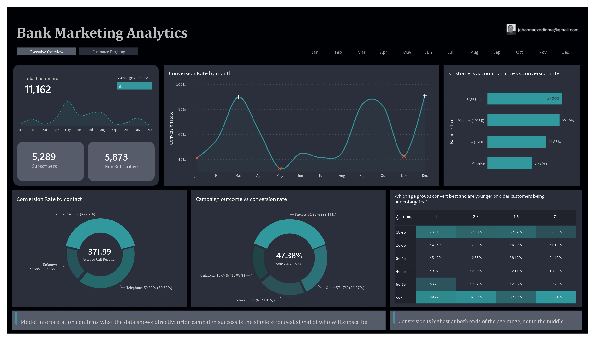
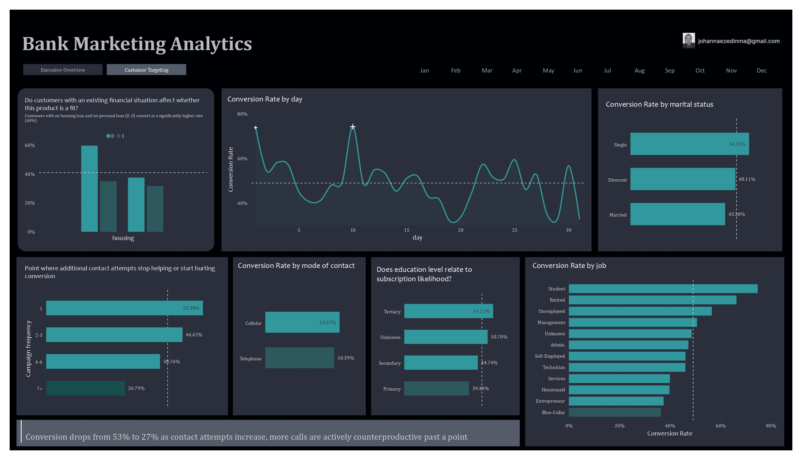
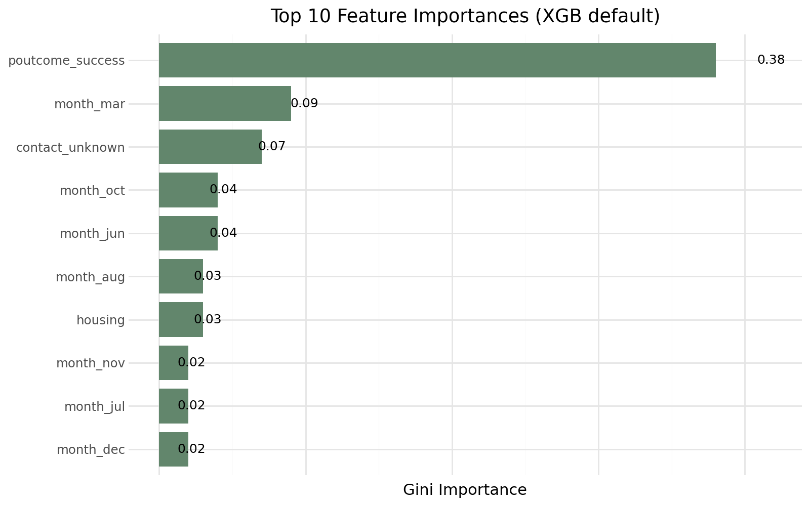
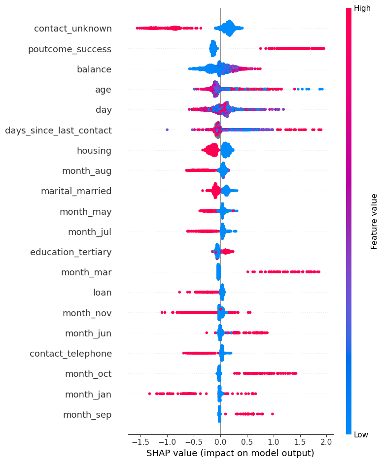
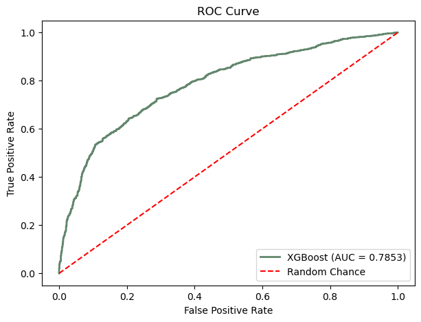

# Bank Marketing Analytics: Understanding Customer Subscription Through Exploratory Data Analysis and Machine Learning

**Author:** Johanna Ezedinma  
**Date:** August 2026

[](https://www.linkedin.com/in/johanna-ezedinma/)
[](https://medium.com/@johannaezedinma) [](https://github.com/Johanna-Ezedinma)

## Overview

Banks invest significant time, budget, and human resources into direct marketing campaigns, yet only a small percentage of contacted customers ultimately subscribe to a term deposit. Understanding what influences customer decisions is essential for improving campaign performance and reducing unnecessary marketing costs.

This project combines data quality assessment, exploratory data analysis, and predictive machine learning to uncover the characteristics of customers who are more likely to subscribe.
By combining business insights with machine learning, it identifies the key factors associated with term deposit subscriptions and demonstrates how predictive analytics can support more targeted, cost-effective marketing campaigns providing actionable business insights that can help marketing teams target customers more effectively and improve future campaign outcomes.

These insights are then used to develop and compare multiple classification models capable of predicting whether a customer will subscribe to a term deposit.

Three machine learning models were developed and evaluated:

- Logistic Regression
- Random Forest
- XGBoost

The final selected model (XGBoost, default parameters) achieved **72% accuracy**, **77% precision**, **59% recall**, an **F1-score of 0.67**, and a **ROC-AUC of 0.785**. Model interpretation using SHAP was performed to identify the features that contributed most to customer subscription predictions.

---

# Business Understanding

Direct marketing remains one of the most widely used customer acquisition strategies in the banking industry. However, every phone call represents a cost in terms of employee time, operational resources, and marketing budget. Contacting every customer without understanding their likelihood of subscribing often results in low conversion rates and inefficient campaign spending.

The objective of this project is to help the bank answer two key business questions:

- Which customer characteristics are associated with term deposit subscriptions?
- Can historical customer and campaign information be used to predict future subscription behaviour?

A reliable predictive model would enable the bank to:

- Prioritize customers with a higher probability of subscribing.
- Reduce unnecessary marketing calls.
- Improve campaign conversion rates.
- Allocate marketing resources more efficiently.
- Support data-driven decision making for future campaigns.

---

# Data Understanding

The dataset used in this project comes from a Portuguese retail bank's direct marketing campaign and contains **11,162 customer records** across **17 variables**. Each record represents a customer contact event and indicates whether the customer subscribed to a term deposit.

The dataset includes customer demographic information, financial characteristics, previous campaign history, and details about the most recent marketing contact.

Before analysis, a comprehensive data quality assessment was conducted.

Key findings included:

- No missing (`NaN`) values.
- No duplicate records.
- `"unknown"` values represent valid business categories rather than missing information (confirmed for `contact` and `poutcome`).
- `pdays = -1` indicates customers who had never been contacted previously; this was separated into two clean fields (`was_previously_contacted` and `days_since_last_contact`) rather than treated as a literal day count.
- Extreme values in account balance and campaign frequency were determined to be genuine customer observations and were retained.

Exploratory Data Analysis was then performed to better understand customer behaviour and campaign performance. The analysis examined:

- Customer demographics
- Financial profiles
- Marketing campaign characteristics
- Previous campaign outcomes
- Relationships between predictor variables
- Subscription distribution across customer segments

**Overall, 47.4% of contacted customers subscribed to a term deposit (5,289 of 11,162).**

Several variables showed noticeable differences between customers who subscribed and those who did not:

- **Past campaign outcome was the strongest single signal found**: customers with a prior successful outcome converted at 91.3%, compared to 40.7%-57.2% for other prior outcomes.



- **More contact attempts consistently reduced conversion**, from 53% on the first attempt down to 27% at 7+ attempts, a clear point of diminishing returns.



- **Month showed the widest swing of any factor**: December (91%), March (90%), and September (84%) far outperformed May (33%), the weakest month.

- **Students (75%) and retirees (66%) converted far above average**, while blue-collar workers (36%) converted well below.
- **Existing loans reduced conversion**, and the effect compounded: customers with both a housing and personal loan converted at just 32%, versus 60% for customers with neither.

Full detail and every segment breakdown is available in | [EDA_Summary ↗](./docs/eda_summary.md) |

---

# Modeling and Evaluation

Following exploratory analysis, the dataset was prepared for machine learning through preprocessing, feature encoding, train-test splitting, and missing value handling where appropriate.

Two variables identified during EDA, `duration` (call length, only known after a call happens) and `campaign` (contact count during the current campaign, not fully known in advance), were deliberately excluded from the feature set to avoid leaking post-outcome information into the model.

Three supervised classification models were developed and compared, with Random Forest and XGBoost each evaluated both with default parameters and after hyperparameter tuning (`RandomizedSearchCV`, 5-fold cross-validation, tuned on the training set only):

| Model                   | Recall   | Precision | F1       | Accuracy | ROC-AUC   |
| ----------------------- | -------- | --------- | -------- | -------- | --------- |
| Logistic Regression     | 0.56     | 0.74      | 0.64     | 0.70     | 0.75      |
| Random Forest (default) | 0.63     | 0.74      | 0.68     | 0.72     | 0.76      |
| Random Forest (tuned)   | 0.60     | 0.76      | 0.67     | 0.72     | 0.78      |
| **XGBoost (default)**   | **0.59** | **0.77**  | **0.67** | **0.72** | **0.785** |
| XGBoost (tuned)         | 0.61     | 0.74      | 0.67     | 0.71     | 0.77      |

**Selected model: XGBoost (default parameters).** It achieved the best ROC-AUC (0.785) of all five models, narrowly ahead of Random Forest (tuned) at 0.782. Notably, this untuned default model outperformed every tuned model in the comparison, for this dataset, algorithm choice mattered more than hyperparameter tuning, which itself produced only small, inconsistent gains. All five models converged within a fairly tight performance band (accuracy 0.70-0.72, ROC-AUC 0.75-0.79), suggesting the available features carry a real but limited amount of predictive signal.

Model interpretation was performed two ways, and they told a partly overlapping, partly different story worth reporting honestly rather than picking one:

- **XGBoost's built-in feature importance** ranked `poutcome_success`, `month_mar`, and `contact_unknown` as the top three drivers.



- **SHAP values** ranked `contact_unknown`, `poutcome_success`, and `day` as the top three, `poutcome_success` remained highly influential either way, while `contact_unknown` and timing-related features (`day`, `month`) were consistently important across both methods.



---

- XGBoost classifier ROC-AUC score of 0.7853 demonstrat solid predictive performance. The model significantly outperforms random chance ($0.50$), effectively ranking high-probability leads above non-converting contacts. This confirms that the underlying features successfully capture customer conversion dynamics to support targeted campaign outreach.

## 

# Conclusion

This project demonstrates how combining exploratory data analysis with predictive machine learning can help financial institutions better understand customer behaviour and improve the effectiveness of direct marketing campaigns.

Beyond developing a predictive model, the exploratory analysis provided valuable insights into the characteristics of customers who are more likely to subscribe, most notably prior campaign success, contact month, and job/age segment, allowing marketing teams to better segment their audience and allocate campaign resources more strategically.

Future work could include incorporating customer lifetime value, evaluating a version of the model that includes `duration` purely for agent-coaching purposes (clearly separated from the production targeting model), and deploying the selected model as an interactive application to support real-time marketing decisions.

## Dataset

**Source**

Bank Marketing Dataset (Portuguese Retail Bank)

**Dataset:** [Bank Marketing Dataset - Kaggle]("https://www.kaggle.com/datasets/janiobachmann/bank-marketing-dataset")

**Dataset Size**

- 11,162 customer records
- 17 features
- Binary target variable (`deposit`)

Each row represents a customer contacted during a direct marketing campaign and indicates whether the customer subscribed to a term deposit.

---

## Repository Structure

```
BANK-MARKETING-ANALYSIS/
│
├── assets/
│
├── data/
│   ├── raw/                        # Source csv file
│   └── processed/                  # Final cleaned dataset
│
├── notebooks/
│   ├── 01_data_profiling.ipynb
│   ├── 02_data_preparation.ipynb
│   ├── 03_exploratory_data_analysis.ipynb
│   └── 04_machine_learning.ipynb
│
├── scripts/
│   ├── profiling.py                # Custom profiling toolkit
│   └── eda.py                      # Custom EDA and visualisation toolkit
│
│
│
├── docs/
│   ├── data_quality_audit.md       # Data audit and profiling findings
│   ├── eda_summary
│   └── ml_insights.md              # Model results and feature importance
│
└── README.md
```

---

---

## Key Business Value

This project demonstrates how combining exploratory data analysis with machine learning can support smarter marketing decisions by:

- Improving customer targeting
- Reducing unnecessary campaign costs
- Increasing marketing efficiency
- Supporting data-driven decision making

---

## Future Improvements

- Incorporate customer lifetime value.
- Include campaign cost analysis.
- Evaluate additional ensemble learning models.
- Deploy the selected model as an interactive web application.
